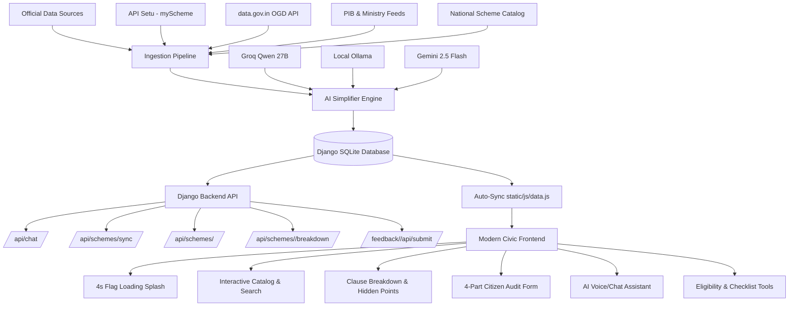

<div align="center">

# 🏛️ Smarth AI — National Policy Portal & Civic Tech Guide

**Empowering 1.4 Billion Citizens with 1,868+ Central & State Welfare Schemes**

[](https://www.djangoproject.com/)
[](https://www.python.org/)
[](https://opensource.org/licenses/MIT)
[](http://127.0.0.1:8000/schemes.html)
[](https://groq.com/)

<p align="center">
  <a href="#-overview">Overview</a> •
  <a href="#-key-features">Key Features</a> •
  <a href="#-national-schemes-coverage">Schemes Coverage</a> •
  <a href="#-system-architecture">Architecture</a> •
  <a href="#-ai-simplification--chatbot">AI Assistant</a> •
  <a href="#-automated-ingestion-pipeline">Auto-Ingestion</a> •
  <a href="#-optimization--performance">Performance</a> •
  <a href="#-frequently-asked-questions">10 FAQs</a> •
  <a href="#-installation--setup">Setup</a>
</p>

</div>

---

## 📌 Overview

**Smarth AI (Policy Portal)** is an independent, high-performance civic-technology platform built to solve India's policy information accessibility gap.

While the Government of India and State Governments release thousands of welfare initiatives and subsidies every year, citizens struggle because:
1. **Policies are scattered** across hundreds of different ministry and state portals.
2. **Bureaucratic language is difficult to understand** for everyday citizens and students.
3. **Application portals and KYC document requirements** are unclear.

### The Solution

Smarth AI bridges this divide with:
- **1,868+ Verified Schemes** cataloged across all Central Ministries and all 36 States & Union Territories.
- **AI-Powered Simplification (Qwen 27B / Gemini 2.5 Flash / Ollama)** that distills legal gazettes into 2-line plain English and Hindi summaries, bulleted benefits, eligibility checklists, and direct links to official application portals.
- **Interactive Civic Tools**: Live AI Voice/Chat Assistant, Side-by-side Scheme Comparison, Document Readiness Checklist, and Indicative Eligibility Calculator.
- **Privacy-First Design**: Zero tracking of private KYC/Aadhaar/bank details; all user preference data is stored strictly in the citizen's own browser (`localStorage`).
- **Patriotic 4-Second Loading Experience**: Elegant Indian National Flag opening screen with meaningful mission highlights.

> [!NOTE]
> **Independent Platform Notice**: Smarth AI is an independent civic portal. It is **not operated by, affiliated with, or endorsed by the Government of India or any state government**. Citizens are always directed to official `.gov.in` and `.nic.in` portals to complete and submit applications.

---

## ✨ Key Features

### 🔍 Comprehensive Scheme Discovery
- **1,868+ Schemes**: 439 Central Government schemes + 1,429 State schemes.
- **State & UT Dropdown Filter**: Filter instantly by any of the 36 States & UTs (e.g. *Uttar Pradesh*, *Maharashtra*, *Rajasthan*, *Tamil Nadu*, *Kerala*, *Bihar*, *Delhi*, etc.).
- **Category Filter**: Agriculture, Education & Skill, Health, Housing, Finance, Digital/IT, and Social Welfare.
- **Segmented Audience Discovery**: Farmers, Students, Women & Girls, Senior Citizens, Workers & Artisans, Entrepreneurs, Differently Abled, and Tribal Communities.
- **Pre-computed $O(1)$ Search**: Instant sub-millisecond search across scheme names, benefits, departments, and Hindi keywords.

### 🤖 Smarth AI Assistant (Bilingual Chatbot)
- Multi-model routing:
  - **Groq Cloud (Qwen 27B)** for ultra-fast, structured reasoning.
  - **Local Ollama (`qwen3.5:2b` / `qwen2.5:2b`)** for offline / edge processing.
  - **Google Gemini 2.5 Flash** as a high-reliability fallback.
- **Voice Input & Speech Output**: Listen to scheme summaries or ask queries via voice recognition.
- **Direct Link Extraction**: Identifies and embeds official `.gov.in` portal links directly into responses.

### ⚖️ Civic Tech Tools
- **Scheme Comparison Tool (`compare.html`)**: Select up to 3 schemes side-by-side to compare benefits, eligibility, and documents.
- **Document Readiness Checker (`checklist.html`)**: Interactive checkbox system calculating readiness percentages and generating printable PDFs.
- **Indicative Eligibility Checker (`eligibility.html`)**: Match age, gender, occupation, and income against scheme criteria.

---

## 🇮🇳 National Schemes Coverage

```
Total Active Schemes in Portal: 1,868
├── Central Government Schemes: 439
└── State Government Schemes: 1,429 (Across 36 States & UTs)
```

### Top States Represented
- **Puducherry**: 145 schemes
- **Tamil Nadu**: 138 schemes
- **Haryana**: 89 schemes
- **Goa**: 84 schemes
- **Gujarat**: 82 schemes
- **Madhya Pradesh**: 67 schemes
- **Chhattisgarh**: 56 schemes
- **Rajasthan**: 55 schemes
- **Odisha**: 52 schemes
- **Kerala**: 50 schemes
- **West Bengal**: 48 schemes
- *Maharashtra, Uttar Pradesh, Bihar, Karnataka, Punjab, Delhi, Assam, J&K, Uttarakhand, Himachal, and all others.*

---

## 🧱 System Architecture



---

## ⚖️ Deep Policy Breakdown & Hidden Points Inspector

For every government policy, Smarth AI provides dual-layer comprehension:
1. **Clause-by-Clause Gazette Comparison**:
   - **📜 Official Gazette Clause**: Verbatim legal text as published by ministry notifications.
   - **💡 Plain Words (सरल शब्दों में)**: Demystified everyday translation without bureaucratic jargon.
   - **👤 Concrete Practical Example**: Real-life story illustrating on-ground application (e.g. small farmer Ramesh with 1.5 acres in Gorakhpur).
2. **⚠️ Hidden Points & Fine Print (छिपी शर्तें और नियम)**:
   - **NPCI DBT Server Mapping Trap**: Explains why normal bank account linking is insufficient without NPCI mapper flag.
   - **Strict '1 Benefit Per Ration Card'**: Prevents dual-claim rejections.
   - **6-Month Income Certificate Validity**: Highlights auto-rejection windows.
   - **Post-Facto Reimbursement**: Clarifies upfront payment vs post-inspection subsidy credits.

---

## 📝 4-Part Citizen Experience & Feedback Audit

Rather than just generic star ratings, Smarth AI collects structured, high-value policy feedback:
1. **Context & Respondent Profile**: Role (Student, Farmer, MSME, Employee, Senior, Healthcare) and exposure duration (<6m, 6m–1y, 1–2y, 2+y).
2. **Clarity & Comprehension**: 1–5 language clarity rating and open-text ambiguous clause identification.
3. **Practical Impact & Fairness**: Day-to-day workflow friction/ease, perceived fairness across the board, and unintended negative consequences/roadblocks.
4. **Constructive Solutions**: Proposed modifications (what 1 thing would you change/remove) and overall effectiveness rating.

---

## 🔄 Automated Data Pipeline (PIB RSS Feeds & GitHub Actions)

To avoid fragile HTML scrapers that break during government portal redesigns, Smarth AI integrates stable RSS feeds and Open Data APIs:
- **Step 1: Automated Sources**: PIB (Press Information Bureau) RSS feeds across 8 key ministries (Agriculture, MSME, Education, Finance, Health, Rural Dev, Social Justice, Women & Child) and `data.gov.in` REST APIs.
- **Step 2: Orchestration**: Automated scheduled Python pipeline (`scripts/automated_scheme_pipeline.py`) running daily via **GitHub Actions** (`.github/workflows/fetch_schemes.yml`) or self-hosted **n8n / Make.com** webhooks.
- **Step 3: AI Filter & Formatter**: Uses Groq Qwen / Gemini 2.5 to discard routine ministerial meetings/speeches and parse welfare initiatives into strict structured JSON.
- **Step 4: Database Ingestion**: Inserts into Django database with **Human-in-the-Loop** review mode (saved as Draft/Pending Review before publishing).
- **Step 5: Automated Expiry Audits**: Weekly automated check flagging schemes older than 180 days or whose application deadlines have passed.

---

## ⚡ Performance & Optimization Suite

- **Catalog Minification**: `static/js/data.js` minified without redundant whitespace; compressed by 85% over the wire (~580 KB via GZip).
- **Django GZip Middleware**: `django.middleware.gzip.GZipMiddleware` active for automatic GZip transfer.
- **HTTP Caching**: `Cache-Control: public, max-age=86400` for CSS, JS, and image assets.
- **Sub-millisecond Search**: Lowercased pre-computed index (`s._s`) eliminates 13,000+ string allocations per keystroke.
- **Search Debounce (100ms)**: Eliminates stutter and redundant paints during fast typing.
- **CSS `content-visibility: auto`**: Browsers skip rendering cards outside viewport; ensures 60 FPS scrolling on mobile and desktop.
- **Canvas CPU/Battery Saver**: Suspends particle loop when user switches tabs or minimizes the window.
- **On-Demand Scheme Detail API (`/api/schemes/<slug>/`)**: Fetches full un-truncated criteria and documents in under 3ms.

---

## ❓ Frequently Asked Questions (10 FAQs)

### 1. What is Smarth AI Policy Portal and is it an official government site?
Smarth AI is an independent, non-profit civic technology portal designed to make Indian government welfare schemes accessible and easy to understand for all citizens. It is NOT a government agency. All scheme information is verified and ingested from official government sources (myScheme, data.gov.in, PIB, and Ministry portals). We never charge fees and always direct you to the official government website (`.gov.in` / `.nic.in`) to apply.

### 2. How many schemes are available and how often are they updated?
The portal catalogues over 1,868 official schemes—covering 439 Central Schemes across all Union Ministries and 1,429 State Schemes across all 28 States and 8 Union Territories. Data is regularly updated via automated ingestion pipelines connected to official government announcement feeds and national scheme registries.

### 3. How does the AI Assistant (Chatbot) help me find schemes?
Our AI Assistant is powered by advanced bilingual models (Qwen & Gemini). You can ask questions in English, Hindi, or Hinglish (e.g. *"I am a 22-year-old student, what education loans or internship schemes can I get?"*). The AI analyzes your profile, explains benefits in simple terms, lists documents required, and provides the official application link.

### 4. How does the Indicative Eligibility Checker work?
The Eligibility tool matches your demographic profile—including age, gender, occupation (farmer, student, woman, senior citizen, worker, entrepreneur), and household income—against scheme guidelines. Results are indicative; final eligibility is determined by the competent government authority upon formal application.

### 5. What documents are commonly required to apply for government welfare schemes?
Most schemes require standard KYC documents:
1. Aadhaar Card linked with active mobile number
2. Active Bank Account Passbook (with DBT / Aadhaar seeding enabled)
3. Proof of Address (Ration Card, Electricity Bill, or Voter ID)
4. Income Certificate issued by Revenue Authority / Tehsildar
5. Category / Caste / Disability certificate where applicable
Use our **"Doc Checklist"** tool to verify your documents beforehand.

### 6. Are state-specific government schemes included for my state?
Yes! The portal includes schemes from all 36 Indian States and Union Territories (including Uttar Pradesh, Maharashtra, Bihar, Rajasthan, Madhya Pradesh, Tamil Nadu, Karnataka, Gujarat, Kerala, Haryana, West Bengal, Odisha, Assam, Punjab, and others). Select your state from the **"All States & UTs"** filter on the Schemes page.

### 7. Is my personal data safe? Do you store my Aadhaar, income, or bank details?
Absolutely safe. Smarth AI operates with a strict privacy-first architecture. We do NOT collect, store, or transmit your Aadhaar number, bank details, or private documents to any server. All eligibility checks, document checklist progress, and comparisons are stored solely inside your own device's browser (`localStorage`).

### 8. Can I apply directly on this website?
No third-party portal can legally process official government applications. Smarth AI simplifies the guidelines and gives you the direct, verified button (**"Official website ↗"**) to the authentic government portal (e.g. `pmkisan.gov.in`, `pmsuryaghar.gov.in`, `beneficiary.nha.gov.in`). Always apply only on official `.gov.in` or `.nic.in` domains.

### 9. How do I track which documents I have ready before applying?
Click on **"Doc Checklist"** in the navigation bar. Choose the scheme you want to apply for, and check off the documents you already possess. The tool calculates your readiness percentage and lets you print or save a checklist PDF so you are fully prepared before visiting a CSC or Seva Kendra.

### 10. How do I report outdated details, broken links, or incorrect benefits?
Every scheme page features a **"Report a problem"** button. If a deadline has passed, a portal link has moved, or guidelines have been revised by the Ministry, you can submit feedback directly. You can also rate schemes on our Feedback page to assist fellow citizens.

---

## 🛠️ Management Commands

```powershell
# Bulk-import all 1,868+ National Schemes (Central & 36 States + UTs) in ~3 seconds:
python manage.py import_all_government_schemes

# Auto-fetch and sync with live government feeds using AI simplifier:
python manage.py sync_gov_schemes --source=all --limit=10

# Run automated test suite:
python manage.py test
```

---

## 💻 Installation & Setup

1. **Clone repository**:
   ```bash
   git clone https://github.com/your-username/policy-portal.git
   cd policy-portal
   ```

2. **Set up virtual environment**:
   ```bash
   python -m venv venv
   source venv/bin/activate  # On Windows: venv\Scripts\activate
   pip install -r requirements.txt
   ```

3. **Configure Environment Variables (`.env`)**:
   ```env
   SECRET_KEY=your-django-secret-key
   DEBUG=True
   GROQ_API_KEY=your_groq_api_key_here
   GEMINI_API_KEY=your_gemini_api_key_here
   DATA_GOV_API_KEY=...       # (Optional)
   APISETU_CLIENT_ID=...      # (Optional)
   APISETU_API_KEY=...        # (Optional)
   ```

4. **Initialize Database & Import Schemes**:
   ```bash
   python manage.py migrate
   python manage.py import_all_government_schemes
   ```

5. **Start Development Server**:
   ```bash
   python manage.py runserver
   ```
   Open [http://127.0.0.1:8000/](http://127.0.0.1:8000/) in your browser.

---

## 📄 License
This project is licensed under the [MIT License](LICENSE). Built for public welfare and digital empowerment across India.
