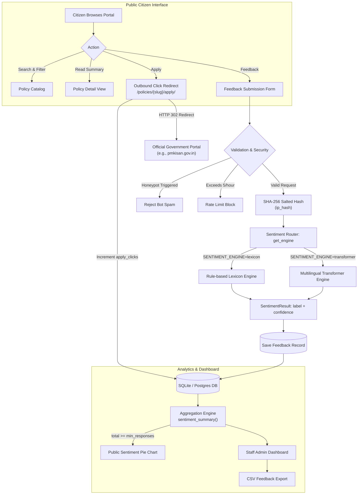
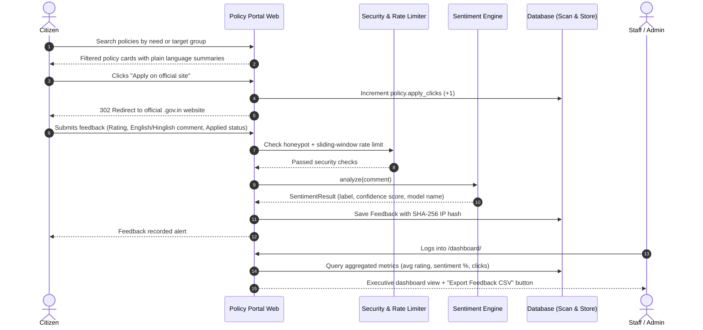

<div align="center">

# 🏛️ SmarthAI — Policy Portal

**Citizen-Centric Government Policy Discovery & Scaled Sentiment Intelligence**

[](https://www.djangoproject.com/)
[](https://www.python.org/)
[](https://opensource.org/licenses/MIT)
[](https://render.com)
[](https://www.docker.com/)

<p align="center">
  <a href="#-overview">Overview</a> •
  <a href="#-key-features">Key Features</a> •
  <a href="#-system-architecture">Architecture</a> •
  <a href="#-workflow">Workflow</a> •
  <a href="#-project-structure">Project Structure</a> •
  <a href="#-technology-stack">Tech Stack</a> •
  <a href="#-installation--setup">Setup</a> •
  <a href="#-deployment-guide">Deployment</a> •
  <a href="#-api--view-routes">Routes</a> •
  <a href="#-contributors">Contributors</a>
</p>

</div>

---

## 📌 Overview

**SmarthAI (Policy Portal)** is an independent, civic-technology platform designed to solve two fundamental problems in democratic governance and citizen welfare:

1. **Policies are hard to find and understand** — Government schemes and draft policies are typically published as dense legal PDFs across hundreds of disjointed department websites. Everyday citizens often do not know a policy exists, cannot decipher the bureaucratic language, and cannot easily determine whether they or their families qualify.
2. **Public opinion is difficult to measure at scale** — When thousands of citizens experience issues with a scheme, complaints are scattered across social media, local offices, and forums. Without automated aggregation, systemic flaws stay invisible until they escalate.

### The Solution

SmarthAI bridges this divide through a transparent, three-pillar system:

- **Plain-Language Policy Catalog** — Verified central and state government schemes summarized in plain English and Hindi, with explicit eligibility criteria, required document checklists, and direct click-tracked links to official government application portals.
- **Citizen Feedback Channel** — Frictionless citizen feedback mechanism requiring no account creation, collecting 1–5 star ratings, qualitative comments in English or Hinglish, and real application conversion status ("Applied", "Started", "Not Applied").
- **Real-Time Sentiment Intelligence** — Dual-engine Natural Language Processing (NLP) pipeline (lexicon-based + multilingual transformer) that classifies public sentiment, calculates confidence scores, and visualizes live sentiment pie charts on policy pages once a representative threshold is reached.

> [!NOTE]
> **Independent Platform Notice**: SmarthAI is an independent portal built by Team 12. It is **not run by, affiliated with, or endorsed by the Government of India or any state government**. Application counts represent outbound link clicks and self-reported answers, not official government registries.

---

## ✨ Key Features

### 🔍 Policy Discovery & Verification
| | Feature | Details |
|---|---|---|
| 🔎 | **Full-Text Multi-Field Search** | Real-time search across policy titles, objectives, benefits, eligibility, and bilingual summaries |
| 🏷️ | **Multi-Criteria Filtering** | Filter policies simultaneously by **Topic**, **Department**, **Level** (Central / State), **State**, and **Target Group** |
| 👥 | **"Browse by Who You Are"** | Segmented target group discovery (Farmers, Students, Women, Senior Citizens, Workers, Entrepreneurs, Minorities, etc.) |
| 🌐 | **Bilingual Plain Language** | Parallel plain-English and Hindi summaries breaking down complex legal gazettes into digestible takeaways |
| 🔒 | **Verification Pipeline** | Policies are kept in `Draft` status until official URLs and last-verified dates are confirmed by an administrator |
| 🔗 | **Click-Tracked Official Redirect** | Outbound redirect engine that increments verified click counters before routing citizens directly to the government application page |

### 💬 Citizen Feedback & Application Insights
| | Feature | Details |
|---|---|---|
| ⭐ | **Granular Ratings** | 1 to 5 star rating system for overall policy satisfaction |
| 🗣️ | **Hinglish & English Submissions** | Accepts colloquial feedback in English, Hindi, and Hinglish (Hindi written in Roman characters) |
| 📋 | **Self-Reported Application Status** | Captures whether the citizen *Applied*, *Started but did not finish*, or *Has not applied* |
| 📍 | **Optional Demographics** | Optional region/state and age bracket selection to enable regional cohort analytics |
| 📊 | **Public Sentiment Charts** | Dynamic Chart.js pie charts revealed after a minimum response threshold (default: 10 responses) |
| 🏷️ | **Sample Data Labelling** | Any simulated or test data is transparently flagged with an `Includes sample data for demo` badge |

### 🧠 Natural Language Processing & Sentiment Engines
| | Feature | Details |
|---|---|---|
| ⚡ | **Lexicon Engine (Default)** | High-speed, zero-dependency rule engine with curated English and Hinglish sentiment dictionaries, negation handling, and phrase boosters |
| 🤖 | **Transformer Engine** | Multilingual deep learning classification candidate for nuanced semantic understanding across mixed scripts |
| 🔄 | **Pluggable Architecture** | Swappable engine architecture configured instantly via the `SENTIMENT_ENGINE` environment variable |
| 📈 | **Benchmark Evaluator** | Built-in CLI command (`evaluate_sentiment`) to benchmark accuracy, precision, and recall on `hinglish_test_set.csv` |

### 🛡️ Trust, Safety & Anti-Spam
| | Feature | Details |
|---|---|---|
| ⏳ | **Sliding-Window Rate Limiting** | Restricts feedback submissions to a maximum of 5 per hour per user |
| 🔐 | **Cryptographic IP Hashing** | Raw IP addresses are never saved; they are salted and hashed via `SHA-256` for privacy preservation |
| 🍯 | **Honeypot Bot Traps** | Invisible decoy form fields that silently catch and reject automated spam submissions |
| 🚫 | **Automatic Flag Exclusion** | Flagged spam comments are immediately removed from sentiment chart calculations and aggregate metrics |

### 📊 Administrative Dashboard & Data Operations
| | Feature | Details |
|---|---|---|
| 📈 | **Executive Summary Metrics** | Real-time KPI cards: Total published policies, total feedback volume, flagged spam count, and overall sentiment distribution |
| 📑 | **Per-Policy Performance Breakdown** | Tabular overview per policy: Response count, sentiment splits (pos/neg/neu), average rating, and outbound apply clicks |
| 📥 | **CSV Data Export** | One-click export of the entire moderated feedback dataset for external analytical tooling or departmental review |
| 👮 | **Extensible Role-Based Access** | Django User model equipped with `role` choices (`Admin`, `Officer`, `Head`, `Citizen`) ready for multi-tier government approvals |

---

## 🧱 System Architecture



---

## 🔄 Workflow



---

## 📂 Project Structure

```
SmarthAI/
├── config/                          # Core project configuration
│   ├── settings.py                  # Settings, WhiteNoise, DB switcher, CSRF
│   ├── urls.py                      # Root URL router & favicon handler
│   ├── wsgi.py                      # Production WSGI application
│   └── __init__.py
│
├── accounts/                        # User authentication & role management
│   ├── models.py                    # User model with Role choices (Admin/Officer/Head/Citizen)
│   ├── admin.py                     # CustomUserAdmin with role filters & fieldsets
│   ├── apps.py
│   └── migrations/
│
├── policies/                        # Policy catalog & discovery
│   ├── models.py                    # Department, TargetGroup, Policy models
│   ├── views.py                     # home, list, detail, apply redirect, about, disclaimer
│   ├── urls.py                      # Policy routing (/policies/, /about/, etc.)
│   ├── admin.py                     # Admin policy verification & publication
│   ├── management/commands/
│   │   ├── load_policies.py         # Loads data/policies_seed.csv into database
│   │   └── load_sample_feedback.py  # Generates test feedback for demo charts
│   └── tests.py                     # Test suites (pages, filters, states, detail)
│
├── feedback/                        # Citizen feedback & abuse prevention
│   ├── models.py                    # Feedback model (sentiment, rating, applied_status)
│   ├── forms.py                     # FeedbackForm with bot honeypot validation
│   ├── services.py                  # SHA-256 IP hashing & sliding-window rate limiting
│   ├── views.py                     # submit_feedback POST handler
│   ├── urls.py                      # Feedback endpoints
│   ├── admin.py                     # Moderation & spam flagging
│   └── migrations/
│
├── sentiment/                       # Natural Language Processing subsystem
│   ├── base.py                      # BaseSentimentEngine interface & SentimentResult dataclass
│   ├── lexicon_engine.py            # Rule-based English/Hinglish sentiment engine
│   ├── transformer_engine.py        # Pretrained multilingual transformer engine
│   ├── services.py                  # get_engine() provider factory
│   ├── evaluate.py                  # Accuracy evaluation logic
│   ├── management/commands/
│   │   └── evaluate_sentiment.py    # Benchmark CLI tool
│   └── tests.py                     # Sentiment engine unit tests
│
├── dashboard/                       # Administrative intelligence & reporting
│   ├── views.py                     # overview metrics & export_feedback_csv
│   ├── urls.py                      # /dashboard/, /dashboard/export/
│   └── apps.py
│
├── templates/                       # Semantic HTML5 UI templates
│   ├── base.html                    # Master layout with responsive nav & footer
│   ├── policies/                    # home.html, list.html, detail.html, _card.html
│   ├── feedback/                    # _form.html modal partial
│   ├── dashboard/                   # overview.html staff dashboard
│   └── pages/                       # how_sentiment.html, about.html, disclaimer.html
│
├── static/                          # Static assets served via WhiteNoise
│   ├── css/site.css                 # Clean, accessible styling
│   ├── js/sentiment_chart.js        # Chart.js dynamic pie chart integration
│   └── img/favicon.svg              # Policy Portal SVG emblem
│
├── data/                            # Datasets & seed files
│   ├── policies_seed.csv            # 100+ researched government schemes
│   ├── feedback_sample.csv          # Annotated demo feedback rows
│   └── hinglish_test_set.csv        # 50+ Hinglish benchmark test cases
│
├── docs/                            # Research & engineering documentation
│   ├── setup_guide.md               # Local development guide
│   ├── demo_script.md               # 5-minute evaluation & walkthrough script
│   ├── test_cases.md                # QA test matrix
│   ├── accuracy_report.md           # Model accuracy benchmarks
│   ├── sentiment_notes.md           # NLP architecture & findings
│   └── policy_research_log.md       # Policy research logs
│
├── Dockerfile                       # Multi-stage production container
├── docker-compose.yml               # Local & VPS container orchestration
├── entrypoint.sh                    # Container bootstrap & migration script
├── Procfile                         # Gunicorn process declaration for Render / Heroku
├── render.yaml                      # Render Blueprint infrastructure specification
├── build.sh                         # Cloud deployment build pipeline
├── runtime.txt                      # Explicit Python runtime (3.12.8)
├── requirements.txt                 # Pinned dependencies
├── .env.example                     # Environment configuration blueprint
└── README.md
```

---

## 🛠️ Technology Stack

<table>
<tr><td valign="top" width="25%"><b>Frontend</b></td><td>

- HTML5 semantic markup, Bootstrap 5.3 (modern layout, responsive grid)
- Chart.js 4.4 (dynamic public sentiment pie charts)
- Vanilla JavaScript (zero heavy JS dependencies, ultra-fast load time)
- Custom CSS with theme variables and high-contrast accessibility

</td></tr>
<tr><td valign="top"><b>Backend</b></td><td>

- Python 3.12, Django 5.0 / 6.0
- Gunicorn (Production WSGI HTTP server)
- WhiteNoise (Compressed static asset serving directly from Python)
- `dj-database-url` (Automatic database switching between SQLite & Postgres)

</td></tr>
<tr><td valign="top"><b>NLP & Sentiment</b></td><td>

- **Lexicon Engine**: Custom rule-based tokenizer, negation parsing, Hinglish romanized vocabulary dictionaries
- **Transformer Engine**: Multilingual transformer model integration (HuggingFace transformers candidate)
- Evaluation harness for benchmarking precision, recall, and F1 on code-mixed datasets

</td></tr>
<tr><td valign="top"><b>Database & Storage</b></td><td>

- SQLite (Zero-config local development default)
- PostgreSQL (Production-ready via `DATABASE_URL` environment injection)

</td></tr>
<tr><td valign="top"><b>DevOps & Deployment</b></td><td>

- Docker & Docker Compose
- Render Cloud (`render.yaml` Blueprint + `build.sh`)
- Procfile for PaaS platforms (Render, Railway, Heroku)

</td></tr>
<tr><td valign="top"><b>Security</b></td><td>

- Python `hashlib` (SHA-256 salted IP hashing)
- CSRF middleware with wildcard origin protection (`https://*.onrender.com`)
- Decoy honeypot form validation against automated scraping bots

</td></tr>
</table>

---

## ⚙️ Installation & Setup

### 🔹 1. Clone the repository

```bash
git clone https://github.com/Yashendra-org/SmarthAI.git
cd SmarthAI
```

### 🔹 2. Create and activate a virtual environment

```bash
# macOS / Linux
python -m venv venv
source venv/bin/activate

# Windows (PowerShell)
python -m venv venv
venv\Scripts\Activate.ps1
```

### 🔹 3. Install dependencies

```bash
pip install -r requirements.txt
```

### 🔹 4. Configure environment variables

Create a `.env` file in the root directory (or copy `.env.example`):

```bash
cp .env.example .env
```

Your `.env` file should look like:
```env
SECRET_KEY=your-secure-random-secret-key
DEBUG=True
ALLOWED_HOSTS=127.0.0.1,localhost
SENTIMENT_ENGINE=lexicon
MIN_RESPONSES_FOR_CHART=10
```

### 🔹 5. Run database migrations & seed data

```bash
# Apply database migrations
python manage.py migrate

# Create the administrator account
python manage.py createsuperuser

# Load the verified policy catalog
python manage.py load_policies --publish-all

# (Optional) Load sample feedback for sentiment demo charts
python manage.py load_sample_feedback
```

### 🔹 6. Start the local server

```bash
python manage.py runserver
```

Open [http://127.0.0.1:8000/](http://127.0.0.1:8000/) in your browser.

---

## 🐳 Docker Setup

Run the entire application in a container with a single command:

```bash
docker compose up -d --build
```

The container automatically executes migrations, collects static assets, seeds policies, and boots Gunicorn on [http://localhost:8000/](http://localhost:8000/).

---

## 🚀 Deployment Guide (Render)

This repository includes native Render Blueprint configuration for seamless deployment.

### Method 1: Web Service Setup (Manual)
1. Go to [dashboard.render.com](https://dashboard.render.com/) and click **New +** &rarr; **Web Service**.
2. Connect repository `Yashendra-org/SmarthAI`.
3. Set the following parameters:
   - **Environment**: `Python 3`
   - **Branch**: `main`
   - **Build Command**: `bash build.sh`
   - **Start Command**: `gunicorn config.wsgi:application --bind 0.0.0.0:$PORT`
4. Add Environment Variables:
   - `DEBUG`: `False`
   - `SECRET_KEY`: *(Generate in Render)*
   - `ALLOWED_HOSTS`: `.onrender.com,localhost,127.0.0.1`
   - `CSRF_TRUSTED_ORIGINS`: `https://*.onrender.com`
   - `SENTIMENT_ENGINE`: `lexicon`
   - `ADMIN_PASSWORD`: *(Your preferred admin password)*

### Method 2: Blueprint Deployment (One-Click)
1. In Render Dashboard, click **New +** &rarr; **Blueprint**.
2. Select `Yashendra-org/SmarthAI`. Render will automatically parse [`render.yaml`](render.yaml) and provision the service.

---

## 📡 API & View Routes

Base URL: `/`

| Method | URL Path | View Controller | Access | Description |
|---|---|---|---|---|
| `GET` | `/` | `policies.views.home` | Public | Home landing page with target groups & topics |
| `GET` | `/policies/` | `policies.views.policy_list` | Public | Searchable policy catalog with state/category/level filters |
| `GET` | `/policies/<slug>/` | `policies.views.policy_detail` | Public | Detailed policy view with plain summaries, docs & chart |
| `GET` | `/policies/<slug>/apply/` | `policies.views.apply_redirect` | Public | Increments `apply_clicks` counter and redirects to official `.gov.in` URL |
| `POST` | `/feedback/<slug>/submit/` | `feedback.views.submit_feedback` | Public | Validates submission, computes sentiment, and records feedback |
| `GET` | `/how-sentiment-works/` | `policies.views.how_sentiment_works` | Public | Transparency page explaining sentiment computation |
| `GET` | `/about/` | `policies.views.about` | Public | Platform mission and overview |
| `GET` | `/disclaimer/` | `policies.views.disclaimer` | Public | Legal transparency notice and independence disclaimer |
| `GET` | `/dashboard/` | `dashboard.views.overview` | Staff | Administrative metrics, per-policy KPIs, and recent comments |
| `GET` | `/dashboard/export/` | `dashboard.views.export_feedback_csv` | Staff | Generates downloadable CSV of all citizen feedback |
| `ANY` | `/admin/` | `django.contrib.admin` | Staff | Django admin panel for policy publishing & moderation |

---

## 🧪 Testing & Model Evaluation

### Running Unit & Integration Tests

```bash
python manage.py test
```

### Benchmarking Sentiment Accuracy

```bash
# Evaluate the active engine against data/hinglish_test_set.csv
python manage.py evaluate_sentiment

# Evaluate all candidate engines and export report
python manage.py evaluate_sentiment --engine all --write
```
Results and accuracy metrics will be written to [`docs/accuracy_report.md`](docs/accuracy_report.md).

---

## 👥 Contributors

<table>
<tr><th>Name</th><th>Role</th><th>Key Responsibilities</th></tr>
<tr>
<td><b>Yashendra Kumar</b></td>
<td>Lead Architect & Backend Engineer</td>
<td>Project architecture, Django core, database models, NLP sentiment engines, anti-spam mechanisms, cloud deployment (Docker/Render), and repository lead.</td>
</tr>
<tr>
<td><b>Team 12 Collaborators</b></td>
<td>Research & Quality Assurance</td>
<td>Government scheme research, policy data verification, Hinglish annotation test set development, and template styling.</td>
</tr>
</table>

---

## 🧭 Roadmap / In Progress

- [ ] **Regional Language Summaries** — Expanding beyond Hindi and English to Bengali, Tamil, Telugu, and Marathi.
- [ ] **Guided Eligibility Wizard** — Interactive 3-step questionnaire (age, income, location, occupation) directing citizens to eligible schemes.
- [ ] **Topic & Aspect-Based Sentiment Analysis** — Dissecting whether negativity stems specifically from technical portal downtime, document complexity, or payment delays.
- [ ] **Department Officer Workflow** — Dedicated restricted views for departmental nodal officers to review verified citizen feedback.
- [ ] **Automated Crawler & Verification Bot** — Scheduled worker checking official `.gov.in` links for broken URLs or revisions.

---

## 📜 License

This project is open-source software licensed under the **[MIT License](LICENSE)**.

---

## 🙏 Acknowledgements

- **Government Portal Data**: Researched from publicly available official department portals across Indian Ministries.
- **Natural Language Processing**: Built with inspiration from research on Hinglish and code-mixed Indian language sentiment processing.
- **Community**: Built as part of Team 12's civic tech innovation initiative.

---

<div align="center">
<h3>🇮🇳 "Democratizing Public Policy Understanding for Every Citizen."</h3>
</div>
